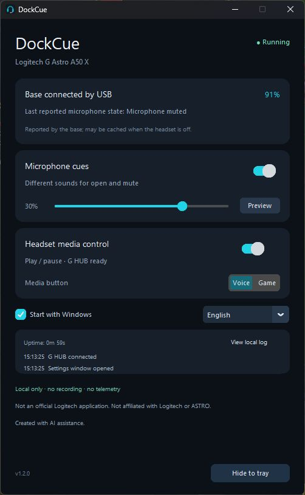

# DockCue

**A small, local-only Windows companion for the Logitech G ASTRO A50 X.**

[Download the latest Windows release](https://github.com/ugurozdagli/dockcue/releases/latest) · [Türkçe](README.tr.md) · [Privacy](PRIVACY.md)

DockCue adds distinct sounds when you flip the microphone open or muted, and lets
you use either **Voice** or **Game** as a play/pause button while keeping your USB
audio connection. It stays in the system tray and shows that the app is running,
the base's USB connection, battery information, and recent local activity.

> This is an independent community support application. It is not an official
> Logitech application and is not affiliated with Logitech or ASTRO.
> Created with AI assistance; changes are reviewed and tested before release.



## Features

- Different microphone-open and microphone-muted cues, with adjustable volume.
- Choose **Voice** or **Game** for Windows play/pause. The previous mix is restored.
- Close or minimize the window to keep running in the tray. Use **Quit DockCue** to exit.
- Optional **Start with Windows**, launching directly in the tray.
- English on non-Turkish Windows; Turkish on Turkish Windows. Manual language selection is available.
- Uptime, recent events, and a small rotating local log for troubleshooting.
- No microphone recording, telemetry, update checks, remote-control server, accounts, or cloud dependency.

## Install

1. Download the Windows x64 ZIP from [Releases](https://github.com/ugurozdagli/dockcue/releases).
2. Extract it into a writable folder you intend to keep. Run `DockCue.exe`.
3. Connect the A50 X base to your PC over USB. For media controls, leave **Logitech G HUB** running.
4. Play a video once in your browser, then briefly press the selected headset button.
5. To start automatically, enable **Start with Windows**. Do not move the app afterward without updating that option.

The program uses Windows' active media session, like a keyboard media key. Another
media app can take that session. Microphone cues use the default Windows audio output.

This is an unsigned community build. Release archives include `SHA256SUMS.txt`;
you can also inspect the source and build the application yourself.

## What the connection status means

The **base remains connected over USB even when the headset is off or charging**.
This is expected. A USB connection or a battery reading does not prove that the
headset's radio link is currently active. DockCue labels the base separately and
treats microphone state as the **last reported** state. Battery information can
be cached by the station; stale readings disappear if replies stop.

Docking, switching the headset off, or disconnecting USB should not close DockCue.
The app retries device/G HUB connections. If a worker fails, it is logged and retried.

## Media-button behavior and limits

DockCue observes changes to the Game/Voice mix. With **Voice** selected, a decrease
is treated as play/pause; with **Game** selected, an increase is treated as play/pause.
The mix is then restored. The other side continues to adjust the mix normally.

- Changing the mix in G HUB or another application can also trigger media when it moves in the selected direction.
- At the selected direction's end-stop, enabling the feature may center the mix once so future presses are detectable.
- Use short presses. Disable media control to restore ordinary Game/Voice behavior.
- The Bluetooth button did not emit USB events in the tested setup and is not remapped.

## Local files and privacy

DockCue stores `data/settings.json` and rotating `data/dockcue.log` files beside
the executable. Logs record app lifecycle and fixed event names, not raw USB
reports, device serials, microphone audio, credentials, or personal paths.

The only network connection made by the app is a **client connection to
`127.0.0.1:9010`**, the local G HUB process. It does not listen on any TCP port.
The address cannot be changed through settings, and proxy variables are bypassed.
Only the device list and the headset mix endpoint are allowed. See [PRIVACY.md](PRIVACY.md).

## Compatibility

- Windows x64, Python 3.11+ for source builds.
- ASTRO A50 X base, USB VID/PID `046D:0B0B`; validated with firmware `1.3.21`.
- Windows 11 was used for live validation. Other firmware versions may need testing.
- A50 Gen 4 / Gen 5 and other headsets are not claimed as supported.
- G HUB is required for media-button mix restoration, but not for microphone cues.

## Build and test

```powershell
python -m venv .venv
.venv\Scripts\python -m pip install -r requirements-build.txt
.venv\Scripts\python -m unittest discover -s tests -v
.venv\Scripts\python tools\build.py
```

The portable ZIP, licenses, and checksum are written to `release/`. Public release
binaries are built by GitHub Actions from this repository, not from a developer's
private workspace. Runtime logs, settings, personal paths, and diagnostics are
excluded from both source control and the release ZIP.

## Contributing

See [CONTRIBUTING.md](CONTRIBUTING.md), [SECURITY.md](SECURITY.md), and [THIRD_PARTY_NOTICES.md](THIRD_PARTY_NOTICES.md).
DockCue is licensed under the [MIT License](LICENSE).
