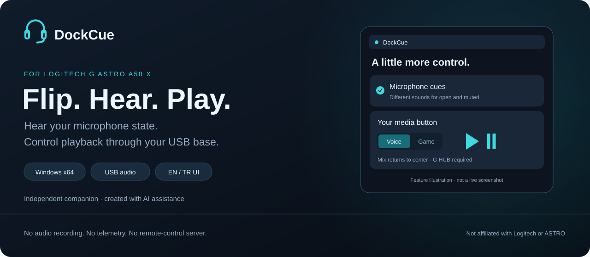
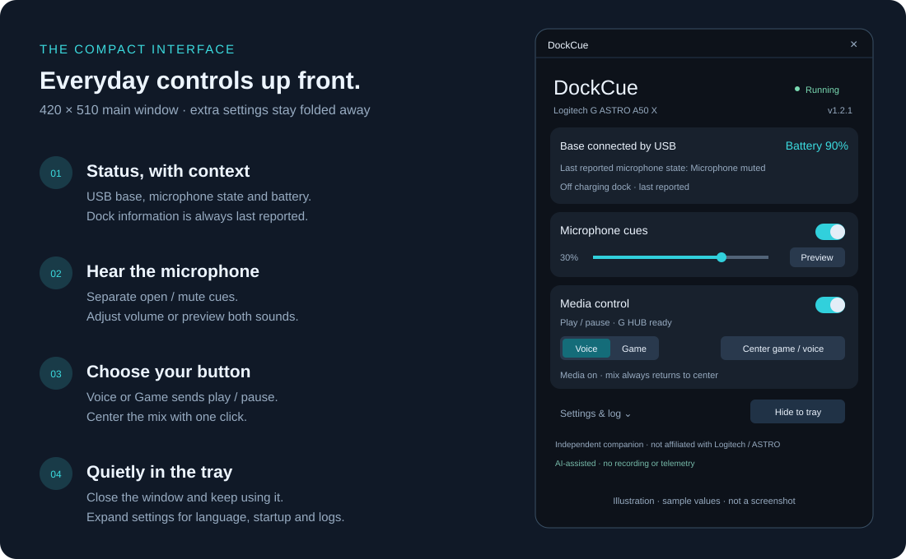
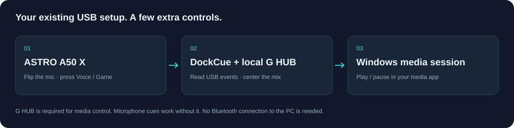

<p align="center">
  
</p>

<p align="center">
  <a href="https://github.com/ugurozdagli/dockcue/releases/latest"></a>
  <a href="https://github.com/ugurozdagli/dockcue/actions/workflows/windows.yml"></a>
  <a href="LICENSE"></a>
  
</p>

<p align="center">
  <strong><a href="https://github.com/ugurozdagli/dockcue/releases/latest">Download for Windows</a></strong>
  &nbsp; · &nbsp; <a href="README.tr.md">Türkçe</a>
  &nbsp; · &nbsp; <a href="#get-started">Get started</a>
  &nbsp; · &nbsp; <a href="PRIVACY.md">Privacy</a>
  &nbsp; · &nbsp; <a href="https://github.com/ugurozdagli/dockcue/issues">Report an issue</a>
</p>

# A few useful extras for your A50 X

DockCue is a small Windows companion for the **Logitech G ASTRO A50 X**. Hear a different cue when you open or mute the microphone, and use **Voice or Game** to play or pause media through your existing USB connection. Keep it in the tray and get on with what you were doing.

> **Independent community application.** Not an official Logitech product and not affiliated with Logitech or ASTRO. Created with AI assistance. No microphone recording, telemetry or remote-control server.

## What you get

| Hear the microphone | Control playback | Keep things simple |
| :--- | :--- | :--- |
| Distinct open and mute sounds, adjustable volume, and a preview button. | Choose **Voice** or **Game** for play / pause. The mix returns to center. | Compact window, system tray, optional startup, and English / Turkish UI. |

## Take a look



*Illustrated overview of the current layout, with sample values. Battery and dock information are the base's **last reported** state; they do not prove that the headset is switched on.*

<details>
<summary>Actual app screenshot — earlier 1.2.0 interface</summary>

The screenshot below shows the previous, larger layout. Version 1.2.1 uses the compact layout described above.


</details>

## Get started

1. **[Download the latest Windows x64 ZIP](https://github.com/ugurozdagli/dockcue/releases/latest)** and extract it into a writable folder you intend to keep.
2. Run **`DockCue.exe`**. Connect the A50 X base to your PC over USB.
3. Leave **Logitech G HUB** running for media controls. Play a video once in your browser.
4. Select **Voice** or **Game** in DockCue, then briefly press that side on the headset.
5. Open **Settings & log** for startup and language options. Closing the window keeps DockCue running in the tray; use **Quit DockCue** in the tray menu to exit.

**Updating?** Quit the old instance before replacing the executable. Keep `data/` to preserve preferences. If you move the app folder, update its **Start with Windows** setting.

The release ZIP is portable and unsigned. `SHA256SUMS.txt` is available on the release page. Public binaries are built by GitHub Actions.

## How it fits your setup



| With media control on | With media control off |
| :--- | :--- |
| The selected Voice / Game direction sends play / pause. Both directions return to center. | Game / Voice adjusts the mix freely. |
| **Center game / voice** resets the balance without sending a media key. | The center button still works when G HUB is connected. |

Windows chooses the active media session, just as it does for a keyboard media key. Another media app can take that session. The Bluetooth button is not remapped.

## Made to stay local

- **No audio recording, accounts, telemetry, automatic updates or cloud dependency.**
- The app is a client of local G HUB at **`127.0.0.1:9010`**. It does not listen on a TCP port.
- Settings and a small rotating diagnostic log stay in the app's **`data/`** folder.
- Logs omit raw USB reports, serials, device paths, credentials, audio and personal filesystem paths.
- Runtime settings, logs and diagnostics are excluded from source control and release archives.

Read the [privacy details](PRIVACY.md) and [security policy](SECURITY.md).

## Compatibility & things to know

| Item | Status |
| :--- | :--- |
| Operating system | Windows x64; live validation on Windows 11 |
| Headset | ASTRO A50 X, USB `046D:0B0B`, tested firmware `1.3.21` |
| G HUB | Needed for media controls and mix centering; not needed for microphone cues |
| Language | Turkish on Turkish Windows, English on other Windows languages; manual override available |
| Other A50 generations | Not claimed as supported |

<details>
<summary>Connection status, mix controls and known limits</summary>

- The **base remains connected by USB when the headset is off or charging**. This is normal. Battery readings may be cached; stale readings disappear if replies stop.
- Microphone and charging-dock status are shown as the last report from the base. They are not a headset power or radio-link indicator.
- Docking, switching the headset off, or unplugging USB should not close DockCue. It retries device and G HUB connections.
- Media mode keeps the mix centered at **6 of 12**. Disable it when you want to adjust the mix freely.
- Dragging the mix in G HUB in the selected direction can also trigger play / pause. Use short headset presses.
- Startup, explicit centering and delayed restoration echoes are suppressed to avoid extra media commands.
- The Bluetooth button did not emit USB events in the tested setup.
- Microphone sounds use the default Windows audio output. Media commands use Windows' active media session.

</details>

<details>
<summary>Build from source</summary>

Requires Windows x64 and Python 3.11+.

```powershell
python -m venv .venv
.venv\Scripts\python -m pip install -r requirements-build.txt
.venv\Scripts\python -m unittest discover -s tests -v
.venv\Scripts\python tools\build.py
```

The portable ZIP, dependency licenses and checksum are written to `release/`. Public binaries are built in GitHub Actions from this repository, not from a developer's private workspace. The G HUB address cannot be changed through settings; requests use a narrow endpoint/verb/value allowlist and bypass environment proxies.

</details>

## Help improve DockCue

Found a bug or tested another firmware? [Open an issue](https://github.com/ugurozdagli/dockcue/issues), include the DockCue / Windows / firmware versions and describe how to reproduce it. Review anything you share; avoid posting device identifiers or private files.

[Changelog](CHANGELOG.md) · [Contributing](CONTRIBUTING.md) · [Third-party notices](THIRD_PARTY_NOTICES.md) · [MIT License](LICENSE)
